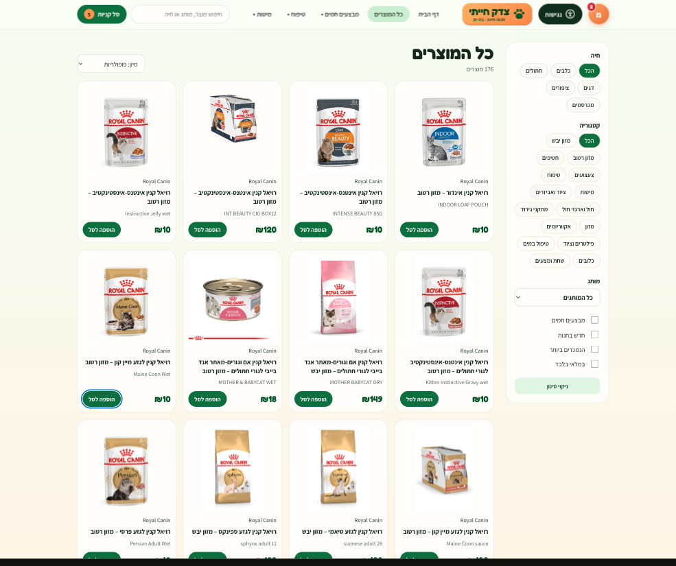
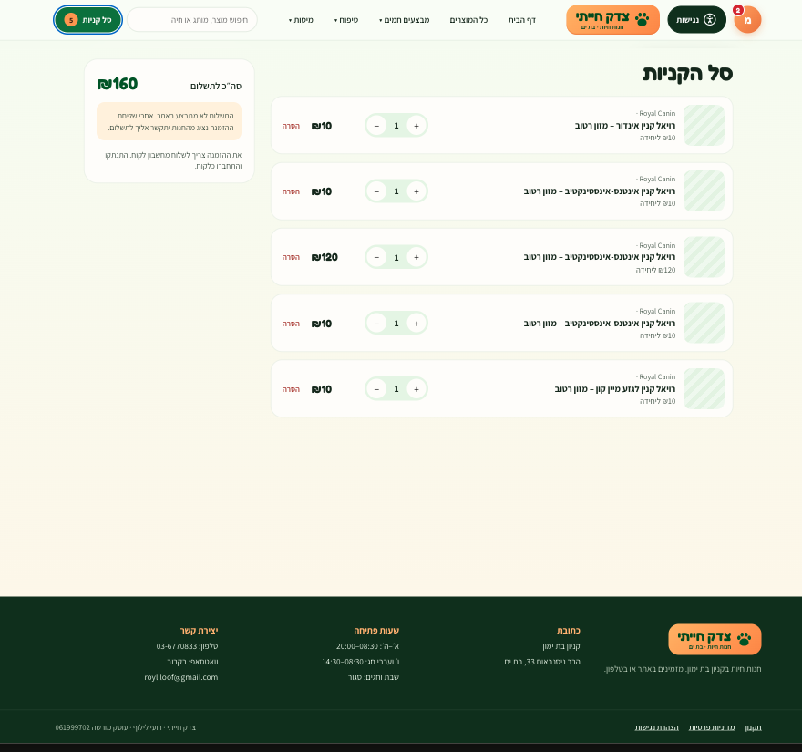
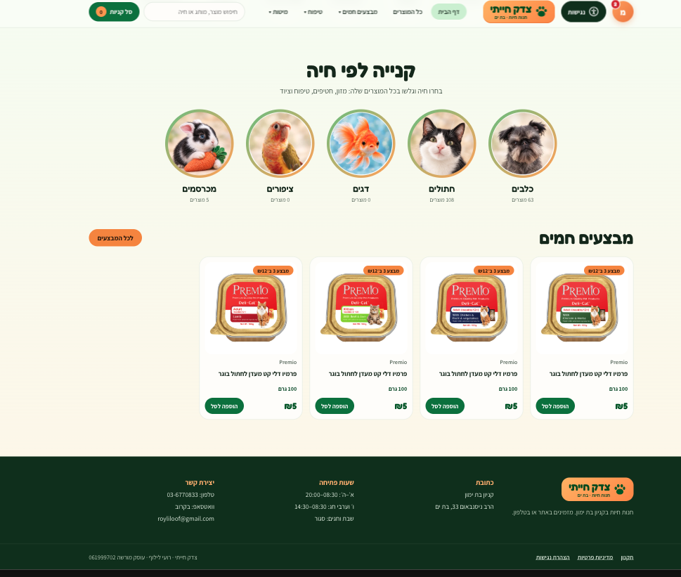
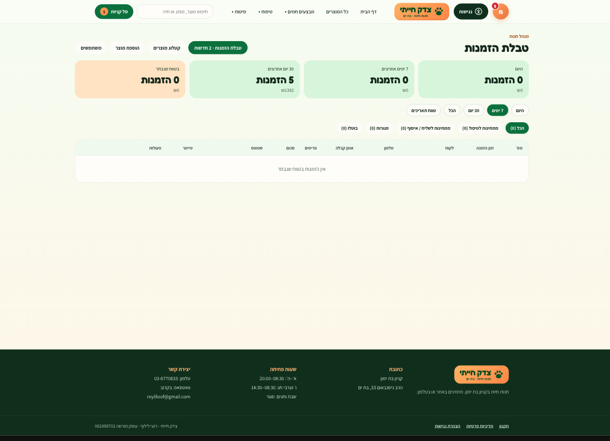

# צדק חייתי – אתר מסחר מקוון לחנות חיות

אתר מסחר בעברית (RTL) לחנות חיות בבת ים. האתר כולל קטלוג של כ-5,000 מוצרים מ-x ספקים ושלושה פורטלים לפי הרשאות: לקוח, עובד ומנהל .

> קוד המקור נמצא בריפו פרטי. בריפו הזה יש תיאור של הפרויקט וצילומי מסך.

## התפקיד שלי
- ייזום הפרויקט ואפיון הדרישות: תפקידים, תהליך הזמנה, משלוחים, מבצעים ומדיניות ביטול
- איסוף ונרמול קטלוגים מהספקים (Excel, תיקיות תמונות)
- ניהול הפיתוח בשיתוף כלי AI (Claude), כולל בדיקות QA ומשוב על חוויית המשתמש
- הקמת תשתית: מסד נתונים ב-Supabase, ניהול גרסאות ב-GitHub

## טכנולוגיות
HTML · CSS · JavaScript · React · PostgreSQL · PL/pgSQL · Supabase (Auth, RLS, Storage) · GitHub

## יכולות עיקריות
- **פורטל לקוח:** חיפוש וסינון לפי חיה, מותג וקטגוריה, עגלת קניות, הזמנה לאיסוף או למשלוח, אזור אישי עם פרטי החיות שלי, היסטוריית הזמנות ושכפול של הזמנה קודמת.
- **פורטל עובד:** טבלת הזמנות עם סטטוסים וטיימר מרגע ההזמנה, ועדכון מלאי.
- **פורטל מנהל:** דוחות מכירות לפי טווח תאריכים, ניהול קטלוג ומחירים, מבצעי כמות וניהול משתמשים.
- **נגישות:** הגדלת טקסט, ניגודיות גבוהה, הדגשת קישורים, עצירת אנימציות וגופן קריא, וגם הצהרת נגישות.

## מנגנונים
- **בקרת גישה לפי תפקידים + Row Level Security:** לקוח רואה רק את הנתונים שלו, עובד מעדכן רק מלאי, מנהל יכול הכול.
- **Triggers במסד:** מונעים העלאת הרשאות עצמית ושינוי מחירים על ידי עובדים.
- **אימות מחירים בצד השרת:** המחיר בהזמנה נלקח מהמסד ולא מהדפדפן.
- **מנוע מבצעים:** מבצעים כמו "3 ב-₪12" מאוחדים אוטומטית בעגלה, גם בין טעמים ומותגים שונים.
- **מודל וריאנטים:** לכל מוצר כמה משקלים, ולכל משקל מחיר, מק״ט ומלאי משלו.
- **ייבוא קטלוגים:** המרה מ-Excel ומשמות קבצים ל-JSON, סיווג אוטומטי לפי מילות מפתח, הסרת כפילויות וטעינה במנות.

## צילומי מסך
| | |
|---|---|
|  |  |
|   |  |
|  |

## סטטוס
אב-טיפוס מלא. המעבר למסד נתונים בענן (Supabase) בתהליך.

---

# Tzedek Hayati – Pet Shop E-commerce

A Hebrew (RTL) e-commerce site for a pet shop in Bat Yam, Israel. The catalog holds about 5,500 products from 11 suppliers, and the site has role-based portals for customers, staff and managers. Launch is planned for September 2026. The source code is in a private repository.

**My role:** I initiated the project, defined the requirements and normalized the supplier data. I led AI-assisted development with Claude and did QA. I also set up the infrastructure: Supabase and GitHub.

**Stack:** HTML, CSS, JavaScript, React, PostgreSQL, PL/pgSQL, Supabase (Auth, Row Level Security, Storage), GitHub.

**Highlights:** role-based access with RLS, server-side price validation, a bundle-deal engine, a product variant model, and a catalog import pipeline from Excel to JSON to SQL.
